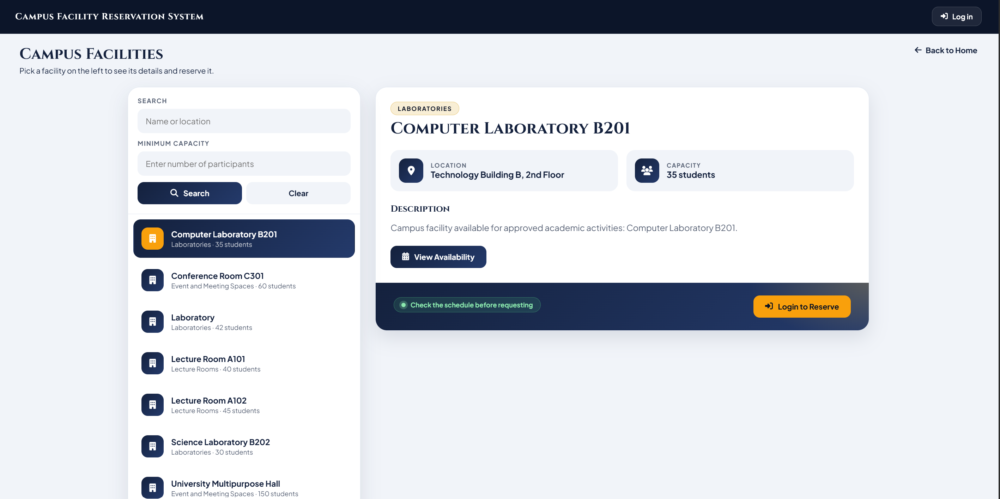
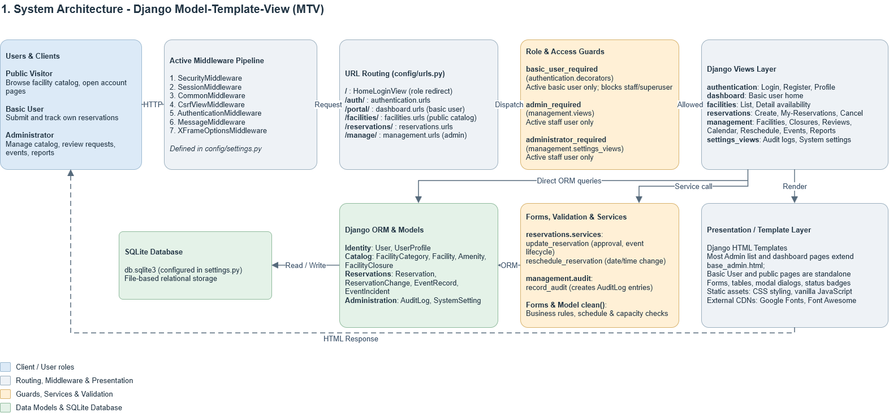
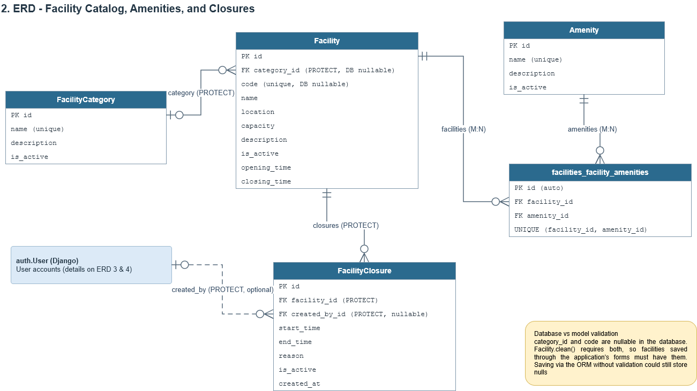
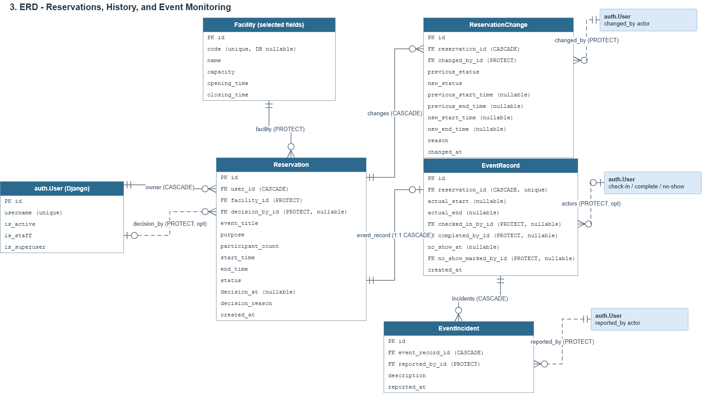
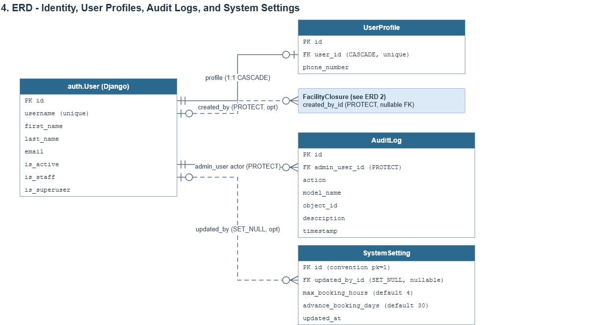
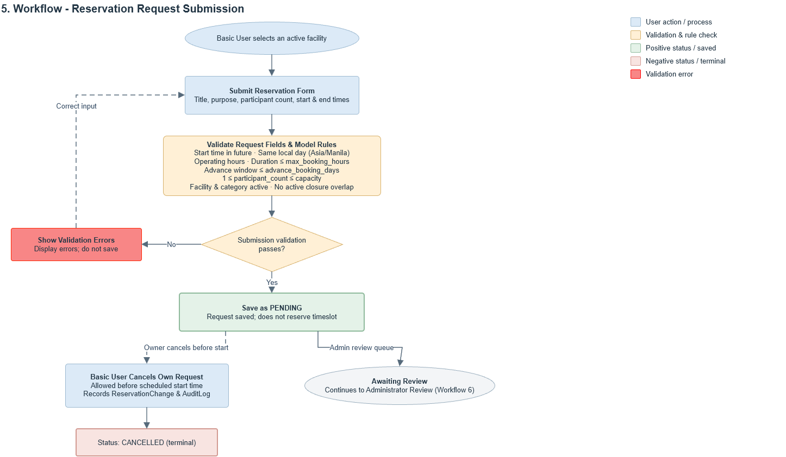
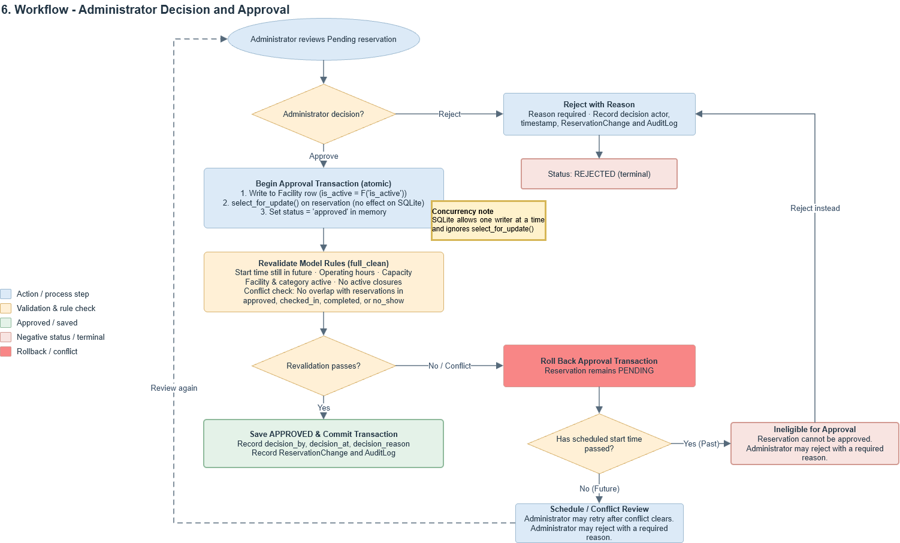
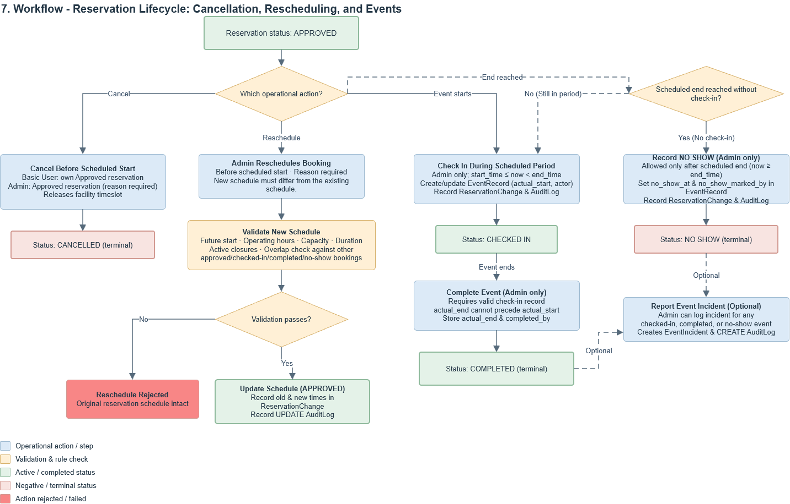
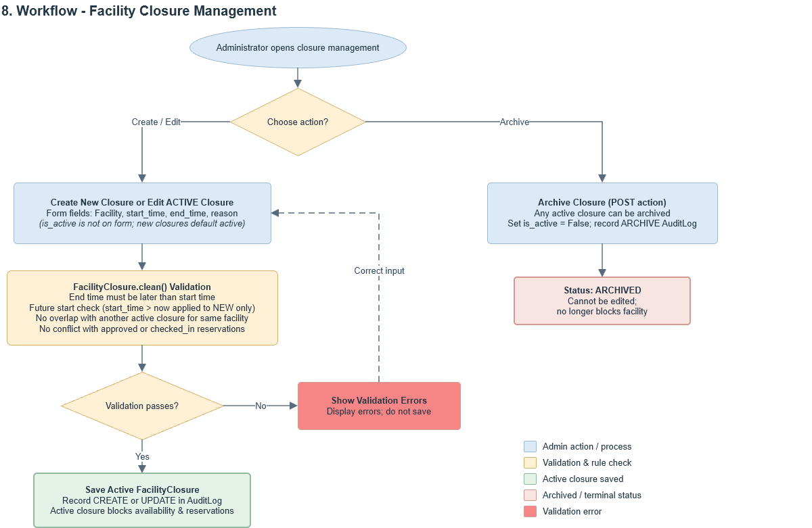

# Campus Facility Reservation System (CFRS)

> IT401W · Project B · Section 4GG2 · Group 2
> Submission package: `IT401W_ProjectB_4GG2_Group2.zip`

CFRS is a Python/Django web application that lets campus users request a facility for an event, while administrators manage facilities, availability, approvals, schedules, event completion, and operational reports. It prevents conflicting approved reservations and keeps an auditable schedule.

**Quick links:** [Installation](#installation-and-setup) · [Overview and features](#project-overview-and-feature-list) · [Business rules](#business-rules-summary) · [System diagrams](#system-diagrams) · [Testing](#testing) · [Evidence index](#evidence-index) · [Limitations](#limitations-and-enhancements) · [Team](#project-team)

---

## Project Team

| Member | Role / responsibilities | Code | Documentation |  Presentation segment |
|---|---|---|---|---|
| CAASI, Humphrey A | `[Role]` | `[modules/features]` | `[documents]` |  `[segment]` |
| DE BELEN, Anne Gheela D | `[Role]` | `[modules/features]` | `[documents]` |  `[segment]` |
| JACINTO, Joshua James E | `[Role]` | `[modules/features]` | `[documents]` |  `[segment]` |
| ORTIZ, Ralth Jasper | `[Role]` | `[modules/features]` | `[documents]` |  `[segment]` |
| PARAISO, Samantha Nicole B | `[Role]` | `[modules/features]` | `[documents]` | `[segment]` |
| SANTOS, Mischa Mae | `[Role]` | `[modules/features]` | `[documents]` | `[segment]` |

**Leadership rotation:** `[who led which period, with goal-setting, task-assignment, coordination, and progress-monitoring records — link to team records]`

**Instructor:** DR. AARON PAUL M. DELA ROSA · **Submission date:** `[date announced by instructor]` · **Presentation and Q&A:** Week 17

---
## Installation and Setup
```bash
# 1. Unzip IT401W_ProjectB_4GG2_Group2.zip to desired location
# 1. From the folder containing manage.py and requirements.txt
python -m venv .venv
# Windows PowerShell: .\.venv\Scripts\Activate.ps1      macOS/Linux: source .venv/bin/activate

# 2. Install pinned dependencies
python -m pip install -r requirements.txt

# 3. Create .env next to manage.py (do NOT commit this into a git repository)
# generate your own key with: python -c "import secrets; print(secrets.token_urlsafe(50))"
#    DJANGO_SECRET_KEY=<generated key>

# 4. Create the database and check the project
python manage.py migrate
python manage.py check

# 5. Load fictional demonstration data (prompts for a 12+ character password)
python manage.py seed_demo

# 6. Run the server
python manage.py runserver     # http://127.0.0.1:8000/
```
---

## Project Overview and Feature List

CFRS has exactly two user levels: **Basic User** and **Admin**. The administrator interface is built entirely with the project's own views, forms, templates, URLs, and ORM operations; Django's built-in admin site is not used. Roles are determined from Django's user flags, and there is no separate Role model. Most development effort went into the admin side, which handles management, approval, operational workflows, reports, settings, and audit.


### Public Visitor

Public visitors can browse the active campus facility catalog at `/facilities/` without logging in, search facilities by keyword, and inspect facility details, operating hours, capacity, and 30-minute availability schedules. Submitting reservation requests or accessing personal bookings requires signing in or creating an account. In the unauthenticated state, the top navigation provides a direct "Log in" action, and facility cards prompt visitors with "Login to Reserve". The authenticated Basic User catalog interface is separately documented below in Figure 8.



*Figure 1. Public visitor facility catalog displaying search filters, facility details, and Login to Reserve actions.*

### Basic User Features

| ID | Feature | What it does |
|---|---|---|
| U1 | Account and profile | Register, sign in, sign out, and edit personal name and contact fields only. Role and activation status are never user-editable. |
| U2 | Browse facilities and availability | Search active facilities by category and capacity; view amenities and 30-minute availability slots. Unavailable slots do not reveal other users or event details. |
| U3 | Submit a reservation request | Request one facility with event title, purpose, participant count, start, and end. Submission creates a **Pending** request and does not reserve the slot. |
| U4 | Track and cancel own reservations | View only own bookings and statuses; cancel Pending or Approved bookings before their start time. |

#### Registration and Sign-In (U1)

Basic users authenticate via a unified sign-in page (`/` or `/auth/`). Authentication validates active credentials and redirects basic users to the user portal (`/portal/`). The sign-in interface also provides a direct navigation link to account registration (`/auth/register/`).


*Figure 2. Basic User sign-in interface.*

Account registration is implemented as a multi-step guided wizard. In Step 1, new users provide their first and last name.


*Figure 3. Account registration wizard (Step 1 — Personal Details).*

In Step 2, users enter their email address and optional contact phone number.


*Figure 4. Account registration wizard (Step 2 — Contact Details).*

In Step 3, users configure their account credentials by specifying a unique username, password, and password confirmation before submitting account registration.


*Figure 5. Account registration wizard (Step 3 — Account Credentials).*

#### User Portal Dashboard (U1)

Upon successful authentication, basic users land on the dedicated user portal dashboard (`/portal/`). The dashboard displays a personalized welcome greeting and provides primary action cards to explore the facility catalog or review existing reservations.


*Figure 6. Basic User portal dashboard.*

#### User Profile Management (U1)

Authenticated users can inspect and update their personal contact details through a modal profile dialog. In accordance with system security rules, the username is displayed as read-only, and role or account activation flags cannot be viewed or altered by the user. Only first name, last name, email address, and phone number can be edited.


*Figure 7. Basic User profile management modal dialog.*

#### Facility Browsing and Availability (U2)

Basic users can browse the campus facility catalog at `/facilities/`, search by keyword (facility name, code, or location), and filter by minimum participant capacity or facility category. Selecting a facility displays its physical location, student capacity, operating hours, active status, and equipped amenities. The availability view visualizes 30-minute time slots across operating hours for a selected date, clearly identifying open slots without exposing private booking details or attendee identities.


*Figure 8. Campus facility catalog and facility details pane (authenticated Basic User session).*


*Figure 9. Facility 30-minute availability schedule grid displaying unavailable slots for Computer Laboratory B201.*

#### Reservation Request Submission (U3)

Basic users submit reservation requests by selecting an active facility and providing the event title, purpose description, anticipated participant count, start date/time, and end date/time. The request modal prominently displays policy constraints, including the 30-day advance booking window, maximum 4-hour reservation duration, facility operating hours limits, and mandatory administrator approval. Newly submitted requests enter **Pending** status and do not block the timeslot until approved by an administrator.


*Figure 10. Reservation submission modal form for Computer Laboratory B201 displaying policy guidelines and input fields.*

#### My Reservations and Cancellation (U4)

Basic users view and track their own reservation requests on the "My Reservations" page (`/reservations/my-reservations/`). Bookings are presented as individual ticket cards displaying the ticket number, facility, event title, date, time window, location, participant count, purpose description, current status (**Pending**, **Approved**, or **Completed**), and administrator remarks. For pending or approved reservations whose start time is in the future, a "Cancel" action is available. Basic users can only access their own reservation records.


*Figure 11. Basic User reservation tracking cards displaying Pending, Approved, and Completed tickets with pre-start cancellation buttons.*

Clicking "Cancel" on an eligible ticket opens an interactive confirmation dialog requiring user confirmation.


*Figure 12. Reservation cancellation confirmation modal dialog prompt.*

Upon confirmation, the reservation is updated to **Cancelled** status, releasing the scheduled slot, and the user interface displays a green success confirmation banner.


*Figure 13. Reservation cancellation workflow result displaying success confirmation banner and Ticket #18 in Cancelled status.*

Basic Users cannot approve requests, reschedule an Approved booking, create closures, check in events, or mark completion.

### Administrator Features

| ID | Feature | What it does |
|---|---|---|
| A1 | Account management | List, search, activate, and deactivate basic-user accounts; view reservation history. Deactivation blocks new sign-ins and transactions without deleting records. |
| A2 | Facilities and amenities | Create, view, update, and archive categories, facilities, and amenities (unique facility code, name, location, capacity, description, operating hours). Past reservations keep their facilities. |
| A3 | Request review and approval | Searchable, paginated queue; approve or reject with actor, timestamp, and reason. Approval rechecks conflicts atomically. |
| A4 | Calendar and rescheduling | Daily/weekly facility schedule with status labels; reschedule an Approved booking with a reason, retaining the original time in history. A failed reschedule leaves the original reservation intact. |
| A5 | Event monitoring and completion | Record check-in, actual start/end, completion, no-show, and incident notes; print a reservation slip. |
| A6 | Closure periods | Create, edit, and archive closure blocks per facility; closures cannot overlap Approved or Checked In bookings. |
| A7 | Dashboard and reports | Live cards (pending requests, upcoming bookings, completed events, active facilities, total booked hours), monthly booking and facility-usage charts, and date-filtered reservation and utilization reports with CSV export. |
| A8 | Audit history and booking settings | Searchable audit log of approvals, rejections, cancellations, rescheduling, check-in, completion, no-show, closures, and master-data changes; configurable maximum event duration and advance-booking window. |

#### Admin Dashboard and Analytics (A7)

The custom administrative dashboard (`/manage/`) provides operational visibility through real-time KPI statistic cards (Pending Requests, Upcoming Bookings, Completed Events, Active Facilities, Total Booked Hours) and analytical visualizations including a 6-month monthly reservations chart and a top-facility utilization breakdown. Metrics dynamically reflect database state changes as administrators approve, reject, or complete reservations.


*Figure 14. Administrator dashboard with KPI statistics cards and analytical charts.*


*Figure 15. Administrator dashboard reflecting updated live metrics following reservation processing.*

#### Account Management and Reservation History (A1)

Administrators manage basic-user accounts at `/manage/users/`. The interface provides a text search filter (by username, full name, or email) and displays account status badges. Administrators can deactivate accounts to prevent sign-ins and new bookings while preserving historical records, and navigate to individual user reservation histories via "View History".


*Figure 16. Administrator basic-user account management table and status controls.*

Administrators can inspect a specific user's complete booking history by clicking "View History" in the account table, which opens the Reservation History modal dialog displaying all past, active, and terminal reservation records for that account.


*Figure 17. User reservation history modal dialog displaying past records for user andrea.reyes.*

#### Facility, Category, and Amenity Management (A2)

Administrators manage physical campus resources across three dedicated modules: facilities (`/manage/facilities/`), categories (`/manage/categories/`), and amenities (`/manage/amenities/`). Facilities track unique alphanumeric codes, categories, physical locations, capacities, operating hours, and active statuses. Categories and amenities feature descriptions, linked facility counts, and archive controls that preserve historical associations with past reservations without cascading deletions.


*Figure 18. Facility catalog administration table with codes, operating hours, capacity, and edit controls.*

Clicking "+ Add New Facility" opens a modal creation form to configure the facility code, name, category, physical location, capacity, and operating hours. Supplementary captures of the facility edit modal and update confirmation alert are cataloged in `documentation/screenshot-index.md`.


*Figure 19. Add New Facility modal dialog with operating hours and capacity configuration.*


*Figure 20. Facility category administration table with descriptions, linked facility counts, and archive controls.*

Clicking "+ Add New Category" opens a modal creation dialog allowing administrators to define the category name and description before activating it for facility classification.


*Figure 21. Add New Category modal dialog with name and description configuration.*


*Figure 22. Facility amenity administration table with active status badges and archive controls.*

Clicking "+ Add New Amenity" opens a modal creation dialog allowing administrators to define the amenity name and description before associating it with facilities.


*Figure 23. Add New Amenity modal dialog with name and description configuration.*

#### Reservation Review Queue and Approval (A3)

The reservation management queue (`/manage/reservations/`) provides a centralized interface for reviewing submitted booking requests. The queue supports search by keyword, multi-status filtering (All Statuses, Pending, Approved, Rejected, Cancelled), facility filtering, date filtering, and pagination. Administrators can approve pending requests or reject them with a mandatory recorded rejection reason. Approval atomically re-validates schedule conflicts and capacity rules within a database transaction.


*Figure 24. Administrator reservation review queue with search, status filters, and paginated records.*

Selecting "Approve" opens an approval decision dialog prompting the administrator for an approval reason before committing the approval atomically. Supplementary captures of the status change audit timeline are cataloged in `documentation/screenshot-index.md`.


*Figure 25. Reservation approval decision modal dialog prompting for approval reason.*

Selecting "Reject" opens a rejection decision dialog requiring the administrator to record a mandatory rejection reason before confirming the terminal rejection.


*Figure 26. Reservation rejection decision modal dialog with mandatory rejection reason textarea.*

#### Reservation Calendar and Rescheduling (A4)

The administrative calendar (`/manage/calendar/`) provides daily and weekly schedule views. The weekly interface visualizes facility availability through timeline bars indicating free vs. booked periods across operating hours. Below the timeline, scheduled reservations for the selected date are listed with facility, event title, reserving user, approved status, and action buttons for "Details" and "Reschedule". Rescheduling an approved booking requires a mandatory reason, revalidates conflicts atomically, and retains the original schedule in audit history.


*Figure 27. Weekly reservation calendar with facility availability timeline bars, approved bookings list, and Reschedule action buttons.*

Clicking "Reschedule" for an approved reservation on the calendar opens a dedicated modal dialog allowing administrators to adjust the start and end times with a mandatory recorded reason.


*Figure 28. Approved reservation rescheduling modal form with datetime selectors and reason input.*

#### Event Monitoring, Check-In, and Completion (A5)

The event monitoring module (`/manage/events/`) supports operational tracking for approved bookings on the day of the event. The interface displays scheduled events with facility, event purpose, reserving user, start/end times, and status. Administrators can access event operations via "View Event" to record attendee check-in during the valid scheduled window (`start_time <= now < end_time`), log event completion with actual timestamps (`actual_end >= actual_start`), record no-shows after the scheduled end time (`now >= end_time`), log event incidents, or generate a printable reservation slip via "Print Slip".


*Figure 29. Administrator daily event monitoring schedule with View Event and Print Slip action buttons.*

> [!NOTE]
> **Screenshot placeholder (Unresolved) — Event check-in, completion, incident reporting forms, and printable slip**
> - **Planned image:** `documentation/screenshots/admin-event-actions.png`
> - **Status:** Missing. The event monitoring schedule table is captured, but the operational action views (check-in recording, completion timestamp form, incident report form, and printable event slip) were not captured.
>
> **Styling & Template Inspection Findings:**
> - **View Event Destination (`event_detail.html`):** *Confirmed source-level finding.* The destination page rendered when clicking "View Event" (`/manage/events/<id>/`) is implemented as an unstyled standalone HTML document. It does not extend `base_admin.html`, does not import static stylesheets, and contains no `<style>` block, causing it to render in plain browser default formatting without admin navigation.
> - **Print-Slip Template (`event_slip.html`):** *Confirmed source-level finding.* The printable slip template (`/manage/events/<id>/slip/`) contains an embedded `<style>` block with print-specific CSS (`@media print`) designed to suppress on-screen controls (`.actions { display: none; }`) and adjust printable margins (`body { margin: 20px; }`).


#### Facility Closure Management (A6)

Administrators manage maintenance shutdowns and institutional closures at `/manage/closures/`. The interface lists active closures displaying facility, start/end timestamps, maintenance reason (e.g., electrical servicing, equipment maintenance, safety inspection), creator attribution, and status. Closures cannot overlap approved or checked-in bookings. Active closures can be edited or archived via dedicated POST actions without permanently deleting historical records.


*Figure 30. Facility closure management table with scheduled closure blocks, reasons, creator attribution, and archive controls.*

Clicking "+ Add New Closure" opens a modal dialog to define the facility, start datetime, end datetime, and closure reason, with an interactive "Preview Conflicts" action to check against existing approved bookings before saving.


*Figure 31. Add New Closure modal dialog with datetime range, reason, and conflict preview.*

#### Reports and Utilization Analytics (A7)

The reporting interface (`/manage/reports/`) delivers operational summaries and facility utilization analytics. Administrators can filter by date range, status, and facility. The report provides summary metric cards (Total Reservations, Approved Count, Completed Count, Booked Hours), a Facility Utilization Report table with booked hours and completed event counts, and a filtered reservation records table. Administrators can export reports via "Export Reservations CSV" and "Export Utilization CSV".


*Figure 32. Reservation reports and utilization analytics dashboard with filter controls and CSV export triggers.*

Exported CSV files provide structured operational records for reservations and facility utilization, suitable for offline reporting and spreadsheet auditing.


*Figure 33. Exported reservation report and facility utilization CSV spreadsheets viewed in an editor.*

#### Administrative Audit History (A8)

The audit log interface (`/manage/audit-logs/`) provides a searchable, filterable record of administrative actions and critical system state changes. Filters allow searching by keyword, action type (Create, Update, Cancel, Reject, Approve), and date range. The table records log ID, timestamp, performing actor (`admin_user`), action verb, affected model (e.g., `FacilityClosure`, `Reservation`), object ID, and descriptive action summaries.


*Figure 34. Searchable and filterable administrative audit log tracking entity actions and state changes.*

#### Booking Policy Settings (A8)

Administrators configure reservation policies at `/manage/settings/`. The form allows updating the Maximum Booking Duration (in hours) and Advance Booking Window (in days). The interface displays the current active configuration, last updated timestamp, and the updating administrator attribution.


*Figure 35. System settings configuration form for maximum booking duration and advance booking window.*

### Access Rules

- One authentication system with role-based redirects: admins go to `/manage/`, basic users to `/portal/`.
- Registration cannot select the admin role; profile editing exposes name and contact fields only.
- Basic-user records are scoped to the signed-in owner; protected actions check that the account is active.
- State-changing actions use POST with CSRF protection.
- `[describe how an additional admin account is created — createsuperuser / documented setup command]`

---

## Technology Stack

| Area | Technology |
|---|---|
| Language | Python `[version tested]` |
| Framework | Django 6.1.1 (pinned in `requirements.txt`) |
| Supporting packages | `asgiref`, `python-dotenv`, `sqlparse` |
| Database | SQLite (`db.sqlite3`) |
| UI | Django templates, HTML, CSS, vanilla JavaScript; Google Fonts and Font Awesome loaded from CDNs |
| Authentication | Django authentication with custom role checks |
| Time zone | `Asia/Manila` |
| Version control | `[Git/GitHub repository link]` |

### Third-Party Packages and Justification

| Package | Version | Why it is used |
|---|---|---|
| `Django` | 6.1.1 | Web framework, ORM, migrations, authentication. |
| `asgiref` | 3.12.1 | Django dependency. |
| `python-dotenv` | 1.2.4 | Loads `DJANGO_SECRET_KEY` from a local `.env` file so secrets stay out of source control. |
| `sqlparse` | 0.6.0 | Django dependency. |
| `[front-end/chart libraries, if any]` | `[version]` | `[justification]` |

None of these packages generate the custom admin side.

Django 6.1 supports Python 3.12, 3.13, and 3.14.

---


### Environment Variables

| Variable | Required | Purpose |
|---|---|---|
| `DJANGO_SECRET_KEY` | Yes | Django secret key. Read from the environment or a local `.env` file. Never commit it. |

### Demonstration Data

`python manage.py seed_demo` creates fictional records only: `[confirm counts against the seed: 3 categories, 6 facilities, 8 amenities, 1 admin, 8 basic users, 24 reservations, 5 closure blocks, __ event records]`, including rejected and cancelled requests, adjacent bookings, completed events, and no-shows `[confirm each is covered]`. The command prompts for a password at least 12 characters long and reuses it for sample accounts it creates.


### Main Routes

| Path | Purpose |
|---|---|
| `/` | Login page for visitors; signed-in users are redirected by role |
| `/auth/` | Authentication routes (registration, login, logout, profile) |
| `/facilities/` | Public facility catalog |
| `/portal/` | Basic User portal |
| `/reservations/my-reservations/` | Signed-in user's reservations |
| `/manage/` | Administrator dashboard |
| `/manage/calendar/` | Administrator reservation calendar |

---

## Business Rules Summary

1. Time intervals are half-open, `[start, end)`. Two intervals conflict when A starts before B ends and A ends after B starts; adjacent bookings may meet at the same endpoint.
2. Pending requests do **not** reserve a slot. Approved, Checked In, Completed, and No Show reservations block overlapping intervals, as do active closures. Cancelled and Rejected reservations release their slots.
3. Approval and rescheduling run inside a database transaction with a locking strategy and revalidate the booking rules.
4. A booking must fit within one local day and the facility's operating hours. The start must be in the future, the end after the start, and participants between 1 and the facility capacity.
5. Defaults: maximum event duration **4 hours**, advance-booking window **30 calendar days**, both configurable by an admin. Times use `Asia/Manila`.
6. No Show can be recorded only after the scheduled end for a booking with no check-in. Actual end cannot precede actual start.
7. A closure cannot overlap an Approved or Checked In booking; the booking must first be rescheduled or cancelled with a reason.
8. Out of scope: payments, deposits, catering, recurring bookings, overnight events, external organizer roles, and automated email/SMS notifications.

### Status Workflow

```
Pending  → Approved | Rejected | Cancelled
Approved → Checked In | No Show | Cancelled   (rescheduling keeps status Approved)
Checked In → Completed
```

`[add a sentence on how terminal states are protected from reopening]`

---

## System Diagrams

The diagrams describe the systems' entity relations, workflows and architecture.

| # | Diagram | Description | Image File |
|---|---|---|---|
| 1 | Application Architecture (Django MTV) | Request pipeline, active middleware, role guards, views, services, ORM, templates, and SQLite database | [`documentation/diagrams/01_architecture_mtv.png`](documentation/diagrams/01_architecture_mtv.png) |
| 2 | ERD — Facility Catalog, Amenities, and Closures | Facility categories, facilities (DB-level nullability vs model clean), amenities, M:N junction, and closures | [`documentation/diagrams/02_erd_catalog_closures.png`](documentation/diagrams/02_erd_catalog_closures.png) |
| 3 | ERD — Reservations, History, and Event Monitoring | Reservations, change history, 1:1 event records, event incident reporting, and actor associations | [`documentation/diagrams/03_erd_reservations_events.png`](documentation/diagrams/03_erd_reservations_events.png) |
| 4 | ERD — Identity, User Profiles, Audit Logs, and Settings | User accounts, 1:1 profile, required admin_user audit logs, and singleton system settings | [`documentation/diagrams/04_erd_identity_audit_settings.png`](documentation/diagrams/04_erd_identity_audit_settings.png) |
| 5 | Workflow — Reservation Request Submission | Form inputs, validation rules, non-blocking Pending status, and owner cancellation | [`documentation/diagrams/05_workflow_request_submission.png`](documentation/diagrams/05_workflow_request_submission.png) |
| 6 | Workflow — Administrator Decision and Approval | Decision paths, mandatory rejection reasons, transaction-based approval, revalidation, rollback, and SQLite locking limitations | [`documentation/diagrams/06_workflow_approval_decision.png`](documentation/diagrams/06_workflow_approval_decision.png) |
| 7 | Workflow — Reservation Lifecycle: Cancellation, Rescheduling, and Events | Pre-start cancellation, rescheduling validation, check-in window, completion, no-show, and incidents | [`documentation/diagrams/07_workflow_reservation_lifecycle.png`](documentation/diagrams/07_workflow_reservation_lifecycle.png) |
| 8 | Workflow — Facility Closure Management | Form fields, new-only future-start rule, conflict checks, and dedicated POST archive action | [`documentation/diagrams/08_workflow_closure_management.png`](documentation/diagrams/08_workflow_closure_management.png) |

---

### 1. Application Architecture (Django MTV)



*Source-level architecture depicting the active middleware stack (`Security`, `Session`, `Common`, `CsrfView`, `Authentication`, `Message`, `XFrameOptions`), root URL dispatch via `HomeLoginView` with role-based redirects, access guards (`basic_user_required`, `admin_required`, `administrator_required`), direct view queries, service encapsulations (`update_reservation`, `reschedule_reservation`, `record_audit`), template layer, and SQLite backend.*

---

### 2. ERD — Facility Catalog, Amenities, and Closures



*Data model representing facility categories, facilities, amenities, and closure blocks. Accurately reflects database-level nullability (`category_id` and `code` nullable in the schema, enforced non-empty by `Facility.clean()`), M:N table `facilities_facility_amenities`, and `PROTECT` foreign key constraints.*

---

### 3. ERD — Reservations, History, and Event Monitoring



*Core reservation data structures illustrating `Reservation` records, audit trail tracking in `ReservationChange` (`CASCADE`), 1:1 `EventRecord` with check-in/completion/no-show timestamps, and `EventIncident` logs linked via foreign keys with `PROTECT` actor references.*

---

### 4. ERD — Identity, User Profiles, Audit Logs, and System Settings



*Supporting data models for identity and administration. Emphasizes that `AuditLog.admin_user` is a required non-nullable foreign key (recording both admin actions and basic-user cancellations), `UserProfile` is 1:1 with `auth.User`, and `SystemSetting` operates as a convention singleton (`pk=1`) with nullable `updated_by` (`SET_NULL`).*

---

### 5. Workflow — Reservation Request Submission



*Basic user booking process: input capture (`title`, `purpose`, `participant_count`, `start_time`, `end_time`), multi-factor model validation (`start_time > now`, same local day in `Asia/Manila`, operating hours, duration limit, advance window, capacity, active category/facility, no closure conflicts), initial `Pending` status without reserving slots, and owner cancellation before start time.*

---

### 6. Workflow — Administrator Decision and Approval



*Administrative review flow: mandatory rejection reason with audit tracking, or approval within a database transaction. The service performs a Facility UPDATE using `F('is_active')`, retrieves the reservation using `select_for_update()`, and revalidates through `full_clean()`. `select_for_update()` does not provide row-level locking on SQLite. The supplied evidence does not establish race-free behavior under simultaneous approvals; see [Testing](#testing) and [Limitations and Enhancements](#limitations-and-enhancements).*

---

### 7. Workflow — Reservation Lifecycle: Cancellation, Rescheduling, and Events



*Post-approval operational workflows: pre-start cancellation releasing timeslots, administrative rescheduling with full conflict revalidation, check-in restricted to the scheduled time window (`start_time <= now < end_time`), event completion requiring valid check-in with `actual_end >= actual_start`, post-end no-show recording (`now >= end_time`), and optional incident logging for attended or no-show bookings.*

---

### 8. Workflow — Facility Closure Management



*Closure maintenance lifecycle: form inputs (`facility`, `start_time`, `end_time`, `reason`), model validation where the future-start check (`start_time > now`) applies strictly to new closures, overlap checks with existing active closures and approved/checked-in bookings (excluding pending requests), and a dedicated POST action to archive active closures without deletion.*

---

## Testing

```bash
python manage.py test
```

A static inventory found **153 `test_*` definitions across seven test modules** (`authentication`, `facilities`, `management`, and four modules in `reservations`); `dashboard/tests.py` is an empty placeholder. A definition count is not a pass count.

**Latest test run:** `[paste date, command, and result summary from your own run]`

**Competing-approvals demonstration (Business Rule 3):** the existing tests cover a conflicting approval being rejected (`test_admin_cannot_approve_conflicting_reservation`) but I found no test that runs two approvals concurrently. `[describe or link the demonstration showing only one of two competing approvals succeeds, or mark as outstanding]`

**Acceptance / usability testing:** `[This part and automated testing under Part 6 of the activity was removed and is not in the Final Project worksheet]`

---

## Evidence Index

| Area | Evidence | Location | Status |
|---|---|---|---|
| User needs | Requirements, two-option comparison and recommendation | `[path]` | Not started |
| User needs | Usability/acceptance testing, resolved issues | `[path]` | Not started |
| User needs | Enhancement responding to feedback or a changed requirement | `[path]` | In progress |
| User needs | Maintenance guidance | `[path]` | Not started |
| System | MTV, database, and workflow diagrams | [System Diagrams](#system-diagrams) | Verified |
| System | Requirements and constraints; limitations; enhancements | `[path]` / [Limitations](#limitations-and-enhancements) | In progress |
| System | Standards, legal compliance, and ethical issues | `[path]` | Not started |
| Technology | Tool justification; Django, ORM, reusable components | `[path]` | In progress |
| Technology | Version-control, testing, configuration records | `[path]` | In progress |
| Technology | Emerging-technology evaluation and adoption recommendation | `[path]` | Not started |
| Professional judgment | Duties, stakeholders, privacy/IP/security/accessibility/bias/conflict-of-interest/public-welfare analysis; decisions and accountability | `[path]` | Not started |
| Team | Allocations, collaboration records, individual contributions, peer feedback | `[path]` | In progress |
| Team | Leadership rotation records and post-feedback improvements | `[path]` | Not started |
| Communication | Technical setup/development documentation | [`INSTALL.md`](INSTALL.md) | Evidence available |
| Communication | Basic User guide, Admin guide, and screenshot traceability | [`documentation/screenshot-index.md`](documentation/screenshot-index.md) | Verified |
| Presentation | Segment per member; Q&A feedback and agreed actions | `[path]` | Not started |

*Status definitions: **Not started** (no work or supporting evidence present), **In progress** (work started but incomplete), **Evidence available** (artifact/document exists but not fully checked against requirement), **Verified** (evidence inspected and sufficient).*

---

## Limitations and Enhancements

### Known Limitations

- SQLite is configured. Concurrent approval and rescheduling behavior has not been established through runtime concurrency testing; a server database such as PostgreSQL would be more suitable for heavy concurrent use.
- `DEBUG = True` and `ALLOWED_HOSTS = []` are hard-coded in `config/settings.py`; review them before any deployment beyond local development.
- Templates load Google Fonts and Font Awesome from external CDNs, so some visuals need an internet connection.
- No automated email or SMS notification delivery.
- Availability is displayed in 30-minute intervals, but reservation start and end times are not forced onto 30-minute boundaries.
- `[additional limitations]`

### Enhancements

| Enhancement | Trigger (feedback / changed requirement) | Status |
|---|---|---|
| `[enhancement]` | `[source]` | `[done / planned]` |

---

## Standards, Privacy, and Ethics

`[summarize relevant standards and legal requirements (for example data-privacy law), how personal data is handled, access-control decisions, accessibility measures, and how ethical issues were addressed; link to the full analysis]`

---

## Repository Layout

```
config/            project settings and root URLs
authentication/    registration, login, profile, role guards
dashboard/         Basic User portal
facilities/        categories, facilities, amenities, closures, public catalog
reservations/      reservations, change history, event records, services, user booking views
management/        custom admin views, audit log, system settings, reports, seed command
documentation/     diagrams, screenshots, screenshot index, and documentation evidence
```

## Contributing and Version Control

`[commit conventions, repository link, issue tracking]`

## License and Acknowledgments

`[license, acknowledgments, third-party assets]`
