### Basic User Features

| ID | Feature | What it does |
|---|---|---|
| U1 | Account and profile | Register, sign in, sign out, and edit personal name and contact fields only. Role and activation status are never user-editable. |
| U2 | Browse facilities and availability | Search active facilities by category and capacity; view amenities and 30-minute availability slots. Unavailable slots do not reveal other users or event details. |
| U3 | Submit a reservation request | Request one facility with event title, purpose, participant count, start, and end. Submission creates a **Pending** request and does not reserve the slot. |
| U4 | Track and cancel own reservations | View only own bookings and statuses; cancel Pending or Approved bookings before their start time. |

#### Registration and Sign-In (U1)

Basic users authenticate via a unified sign-in page (`/` or `/auth/`). Authentication validates active credentials and redirects basic users to the user portal (`/portal/`). The sign-in interface also provides a direct navigation link to account registration (`/auth/register/`).

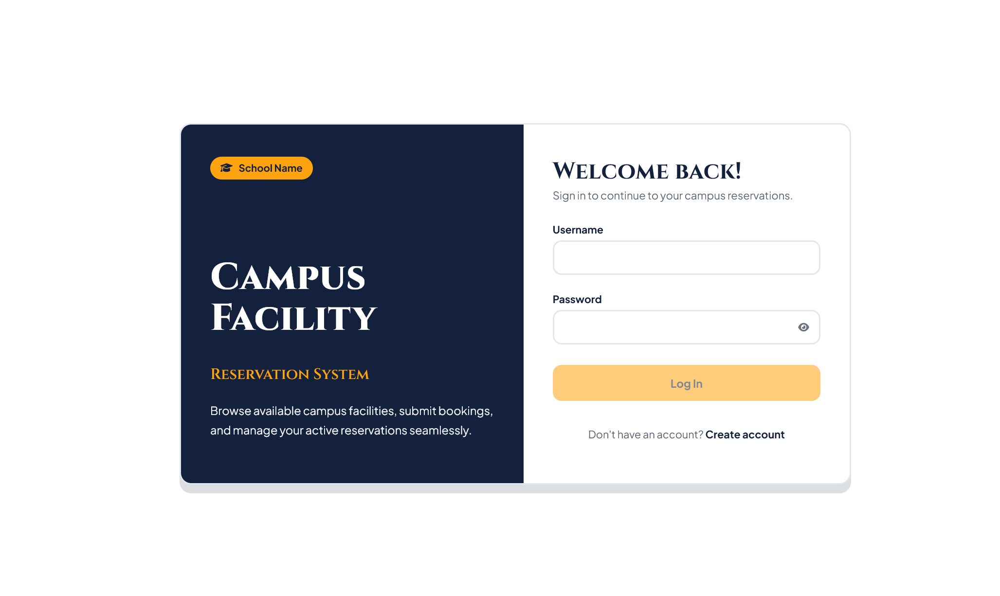

*Figure 2. Basic User sign-in interface.*

Account registration is implemented as a multi-step guided wizard. In Step 1, new users provide their first and last name.

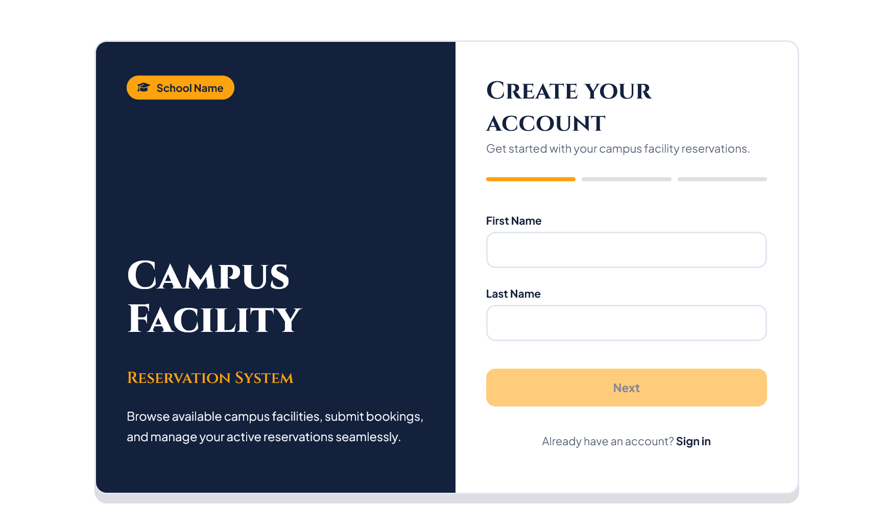

*Figure 3. Account registration wizard (Step 1 — Personal Details).*

In Step 2, users enter their email address and optional contact phone number.

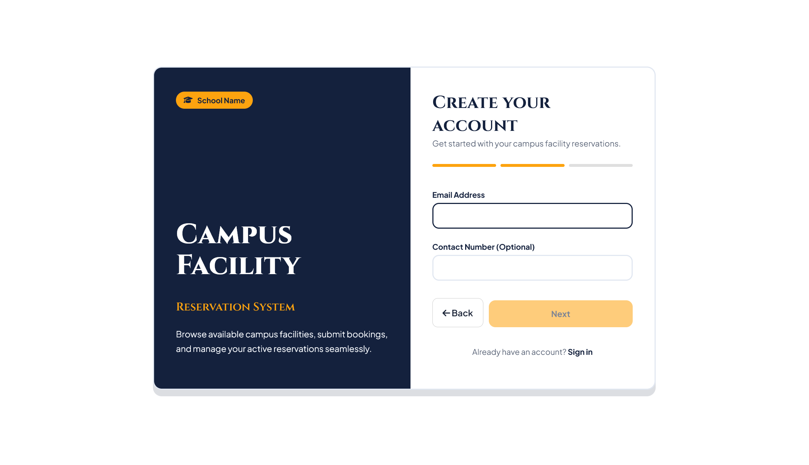

*Figure 4. Account registration wizard (Step 2 — Contact Details).*

In Step 3, users configure their account credentials by specifying a unique username, password, and password confirmation before submitting account registration.

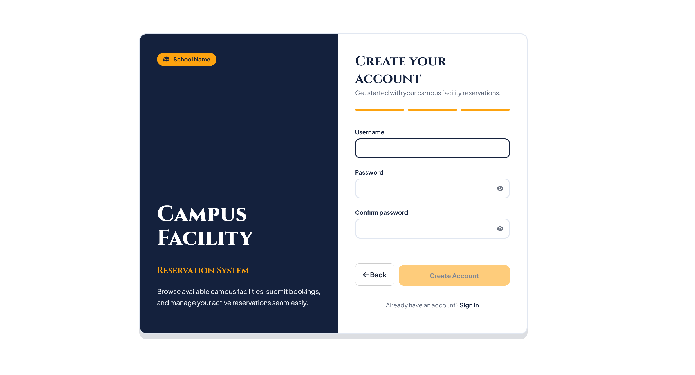

*Figure 5. Account registration wizard (Step 3 — Account Credentials).*

#### User Portal Dashboard (U1)

Upon successful authentication, basic users land on the dedicated user portal dashboard (`/portal/`). The dashboard displays a personalized welcome greeting and provides primary action cards to explore the facility catalog or review existing reservations.

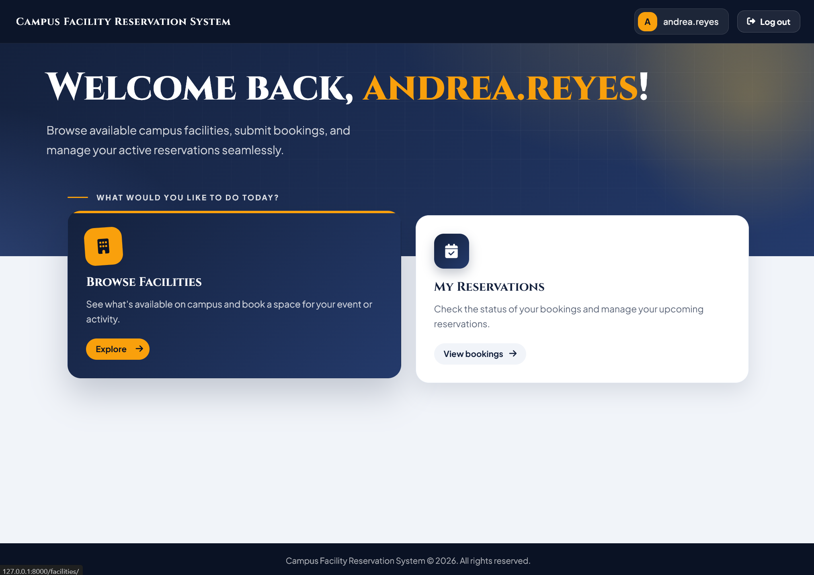

*Figure 6. Basic User portal dashboard.*

#### User Profile Management (U1)

Authenticated users can inspect and update their personal contact details through a modal profile dialog. In accordance with system security rules, the username is displayed as read-only, and role or account activation flags cannot be viewed or altered by the user. Only first name, last name, email address, and phone number can be edited.

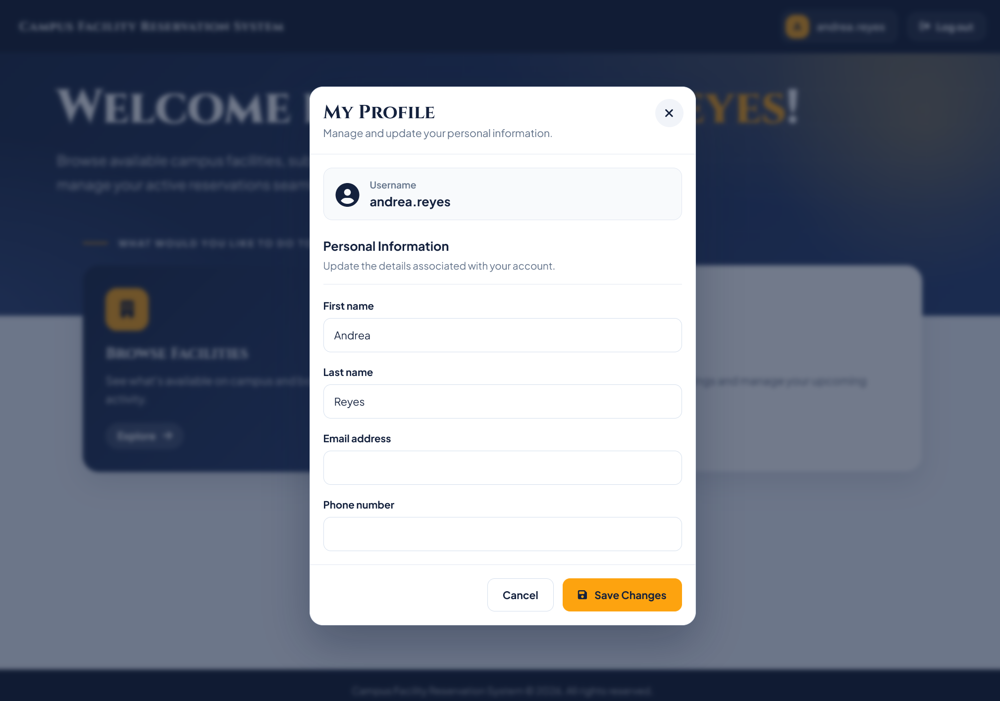

*Figure 7. Basic User profile management modal dialog.*

#### Facility Browsing and Availability (U2)

Basic users can browse the campus facility catalog at `/facilities/`, search by keyword (facility name, code, or location), and filter by minimum participant capacity or facility category. Selecting a facility displays its physical location, student capacity, operating hours, active status, and equipped amenities. The availability view visualizes 30-minute time slots across operating hours for a selected date, clearly identifying open slots without exposing private booking details or attendee identities.

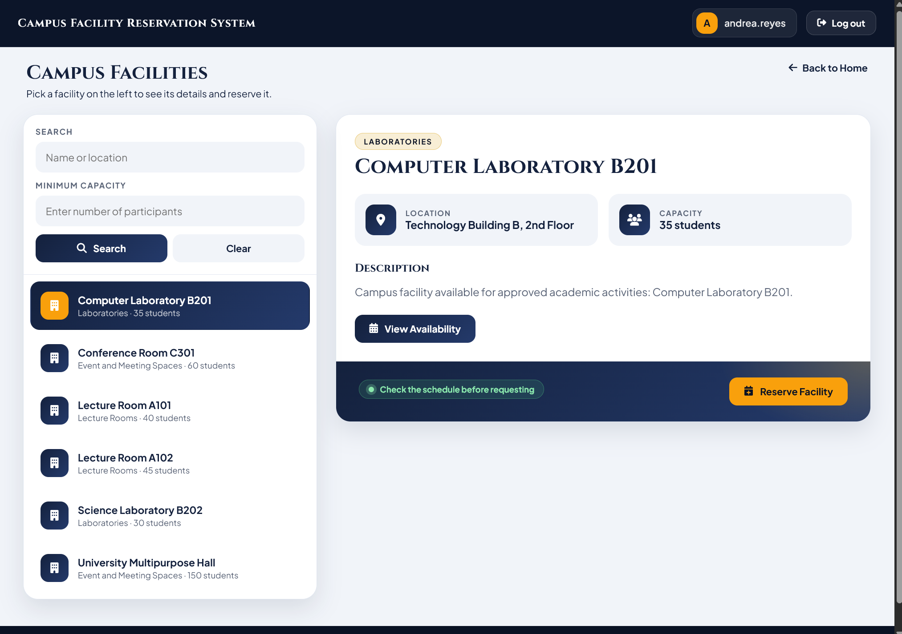

*Figure 8. Campus facility catalog and facility details pane (authenticated Basic User session).*

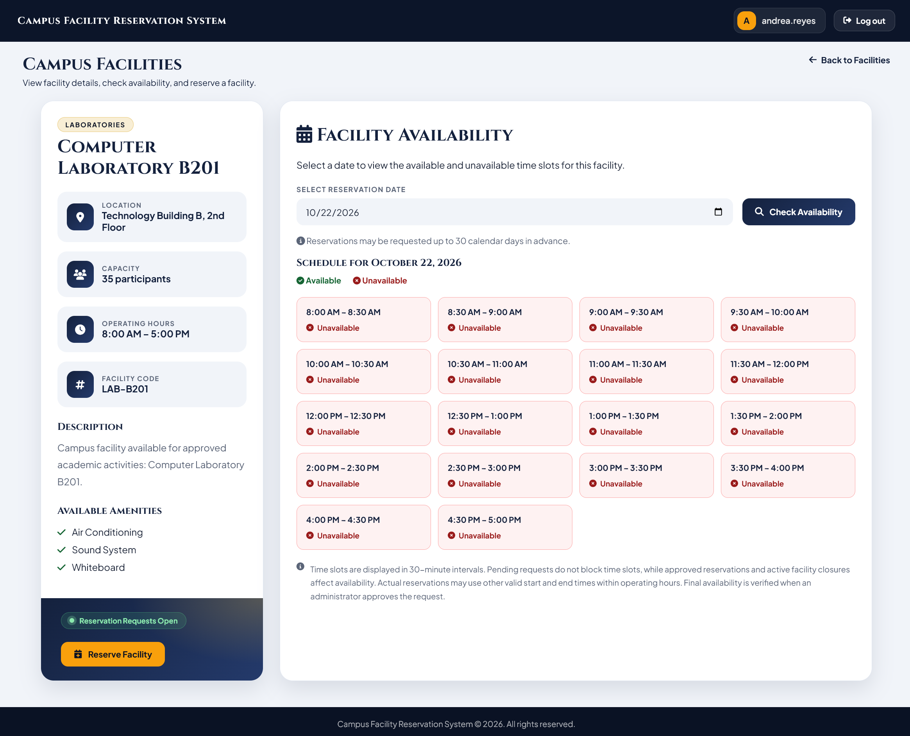

*Figure 9. Facility 30-minute availability schedule grid displaying unavailable slots for Computer Laboratory B201.*

#### Reservation Request Submission (U3)

Basic users submit reservation requests by selecting an active facility and providing the event title, purpose description, anticipated participant count, start date/time, and end date/time. The request modal prominently displays policy constraints, including the 30-day advance booking window, maximum 4-hour reservation duration, facility operating hours limits, and mandatory administrator approval. Newly submitted requests enter **Pending** status and do not block the timeslot until approved by an administrator.

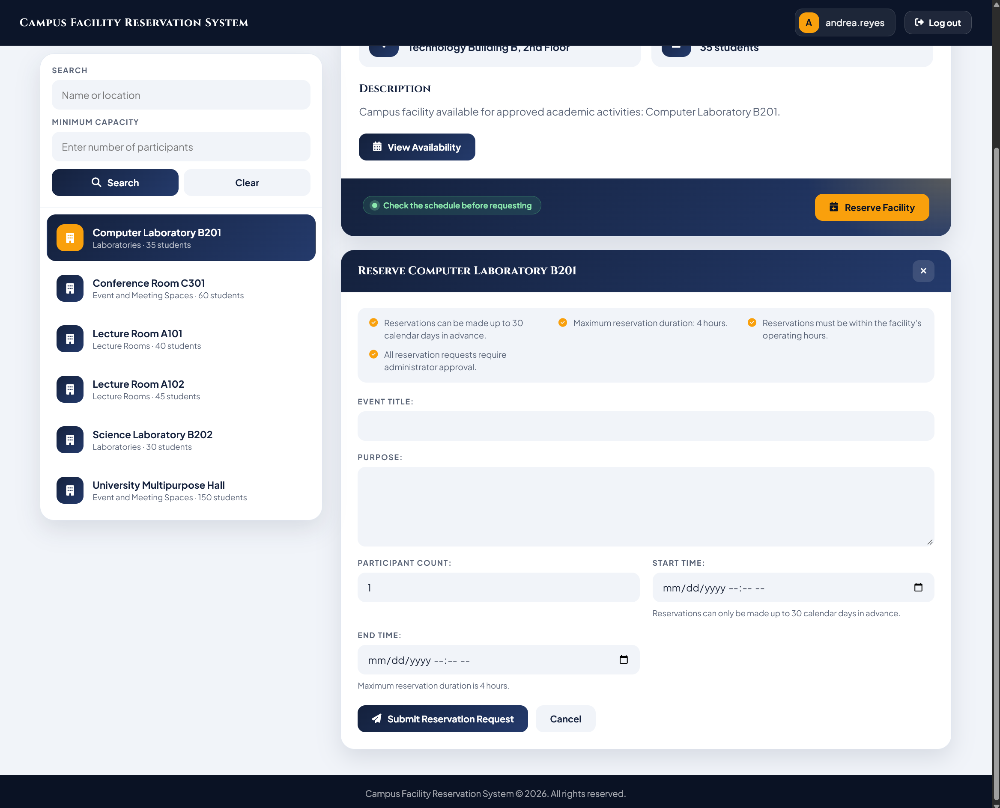

*Figure 10. Reservation submission modal form for Computer Laboratory B201 displaying policy guidelines and input fields.*

#### My Reservations and Cancellation (U4)

Basic users view and track their own reservation requests on the "My Reservations" page (`/reservations/my-reservations/`). Bookings are presented as individual ticket cards displaying the ticket number, facility, event title, date, time window, location, participant count, purpose description, current status (**Pending**, **Approved**, or **Completed**), and administrator remarks. For pending or approved reservations whose start time is in the future, a "Cancel" action is available. Basic users can only access their own reservation records.

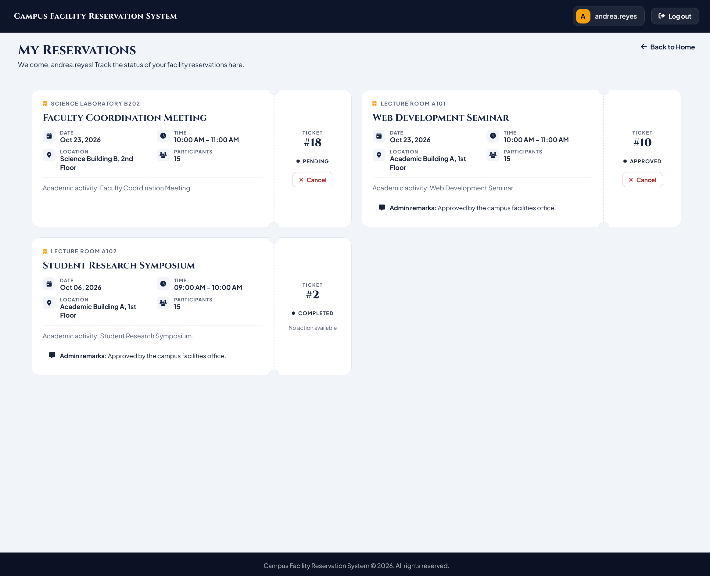

*Figure 11. Basic User reservation tracking cards displaying Pending, Approved, and Completed tickets with pre-start cancellation buttons.*

Clicking "Cancel" on an eligible ticket opens an interactive confirmation dialog requiring user confirmation.

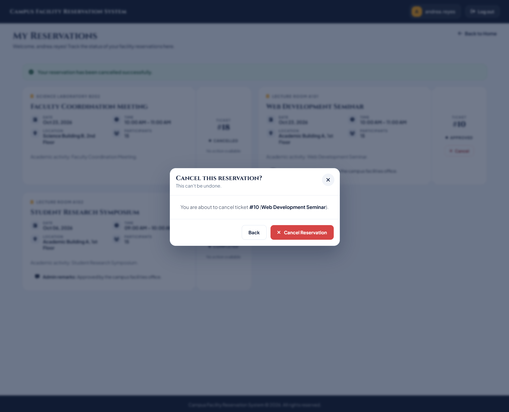

*Figure 12. Reservation cancellation confirmation modal dialog prompt.*

Upon confirmation, the reservation is updated to **Cancelled** status, releasing the scheduled slot, and the user interface displays a green success confirmation banner.

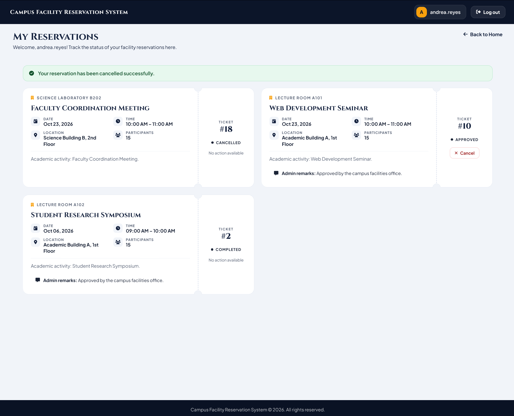

*Figure 13. Reservation cancellation workflow result displaying success confirmation banner and Ticket #18 in Cancelled status.*

Basic Users cannot approve requests, reschedule an Approved booking, create closures, check in events, or mark completion.

### Administrator Features

| ID | Feature | What it does |
|---|---|---|
| A1 | Account management | List, search, activate, and deactivate basic-user accounts; view reservation history. Deactivation blocks new sign-ins and transactions without deleting records. |
| A2 | Facilities and amenities | Create, view, update, and archive categories, facilities, and amenities (unique facility code, name, location, capacity, description, operating hours). Past reservations keep their facilities. |
| A3 | Request review and approval | Searchable, paginated queue; approve or reject with actor, timestamp, and reason. Approval rechecks conflicts atomically. |
| A4 | Calendar and rescheduling | Daily/weekly facility schedule with status labels; reschedule an Approved booking with a reason, retaining the original time in history. A failed reschedule leaves the original reservation intact. |
| A5 | Event monitoring and completion | Record check-in, actual start/end, completion, no-show, and incident notes; print a reservation slip. |
| A6 | Closure periods | Create, edit, and archive closure blocks per facility; closures cannot overlap Approved or Checked In bookings. |
| A7 | Dashboard and reports | Live cards (pending requests, upcoming bookings, completed events, active facilities, total booked hours), monthly booking and facility-usage charts, and date-filtered reservation and utilization reports with CSV export. |
| A8 | Audit history and booking settings | Searchable audit log of approvals, rejections, cancellations, rescheduling, check-in, completion, no-show, closures, and master-data changes; configurable maximum event duration and advance-booking window. |

#### Admin Dashboard and Analytics (A7)

The custom administrative dashboard (`/manage/`) provides operational visibility through real-time KPI statistic cards (Pending Requests, Upcoming Bookings, Completed Events, Active Facilities, Total Booked Hours) and analytical visualizations including a 6-month monthly reservations chart and a top-facility utilization breakdown. Metrics dynamically reflect database state changes as administrators approve, reject, or complete reservations.

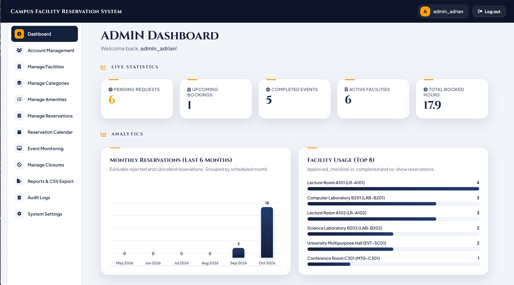

*Figure 14. Administrator dashboard with KPI statistics cards and analytical charts.*

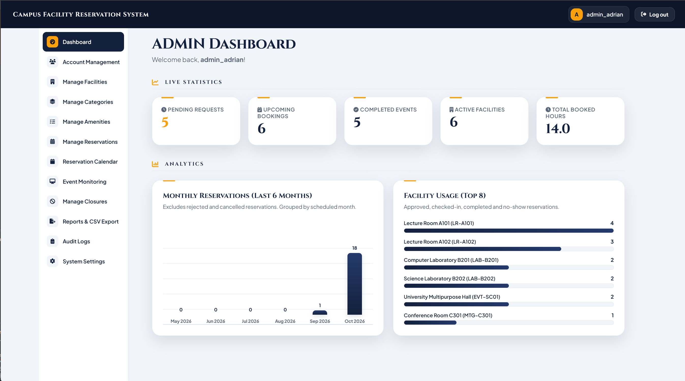

*Figure 15. Administrator dashboard reflecting updated live metrics following reservation processing.*

#### Account Management and Reservation History (A1)

Administrators manage basic-user accounts at `/manage/users/`. The interface provides a text search filter (by username, full name, or email) and displays account status badges. Administrators can deactivate accounts to prevent sign-ins and new bookings while preserving historical records, and navigate to individual user reservation histories via "View History".

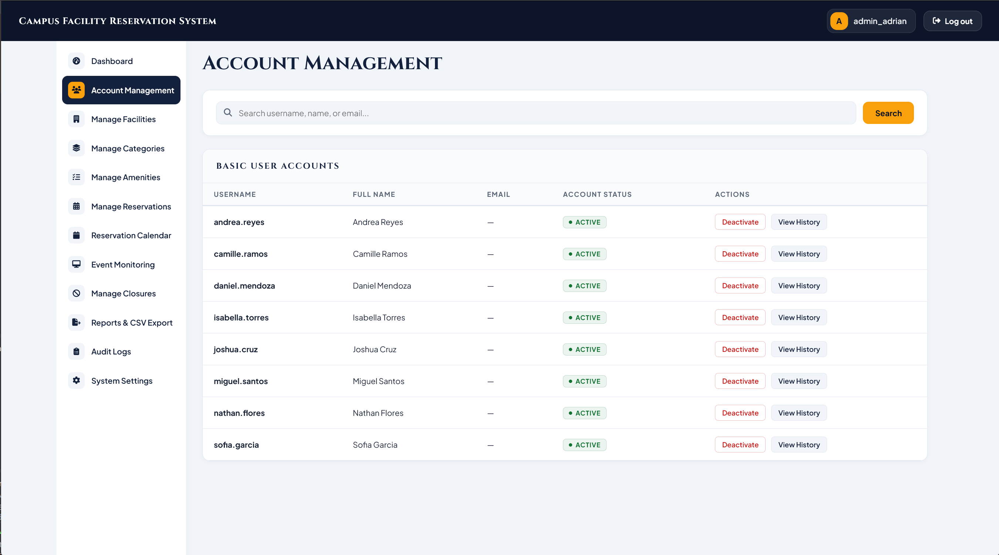

*Figure 16. Administrator basic-user account management table and status controls.*

Administrators can inspect a specific user's complete booking history by clicking "View History" in the account table, which opens the Reservation History modal dialog displaying all past, active, and terminal reservation records for that account.

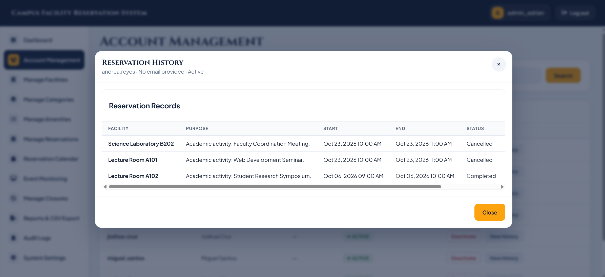

*Figure 17. User reservation history modal dialog displaying past records for user andrea.reyes.*

#### Facility, Category, and Amenity Management (A2)

Administrators manage physical campus resources across three dedicated modules: facilities (`/manage/facilities/`), categories (`/manage/categories/`), and amenities (`/manage/amenities/`). Facilities track unique alphanumeric codes, categories, physical locations, capacities, operating hours, and active statuses. Categories and amenities feature descriptions, linked facility counts, and archive controls that preserve historical associations with past reservations without cascading deletions.

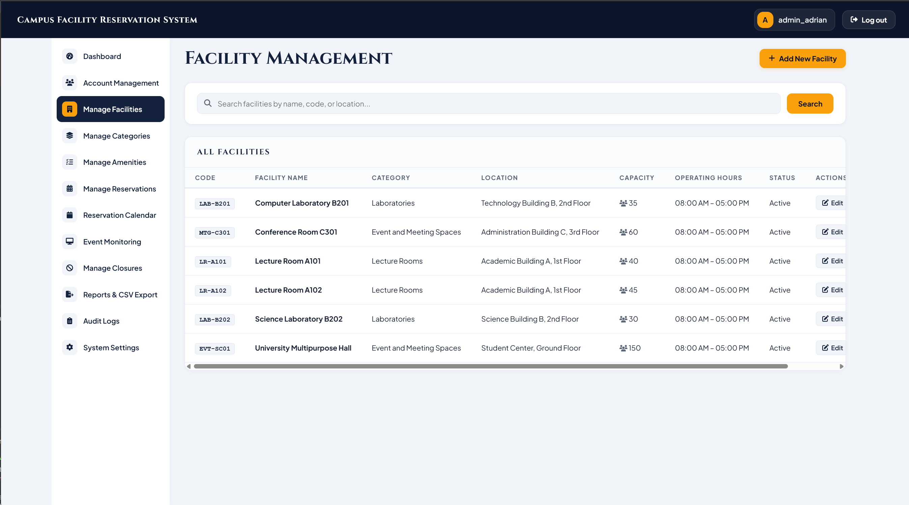

*Figure 18. Facility catalog administration table with codes, operating hours, capacity, and edit controls.*

Clicking "+ Add New Facility" opens a modal creation form to configure the facility code, name, category, physical location, capacity, and operating hours. Supplementary captures of the facility edit modal and update confirmation alert are cataloged in `screenshot-index.md`.

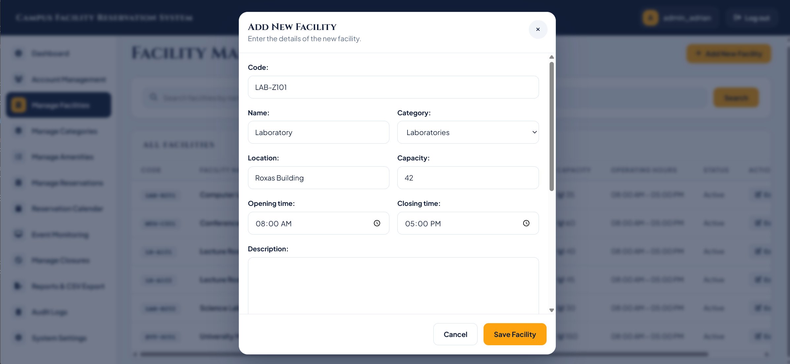

*Figure 19. Add New Facility modal dialog with operating hours and capacity configuration.*

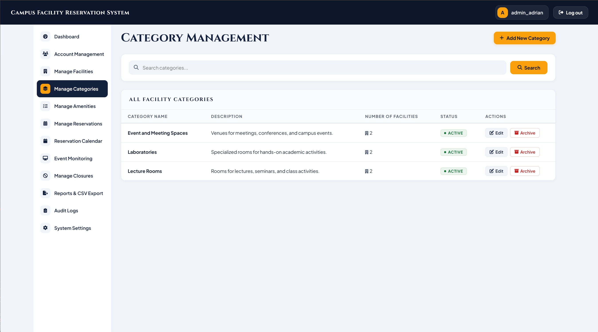

*Figure 20. Facility category administration table with descriptions, linked facility counts, and archive controls.*

Clicking "+ Add New Category" opens a modal creation dialog allowing administrators to define the category name and description before activating it for facility classification.

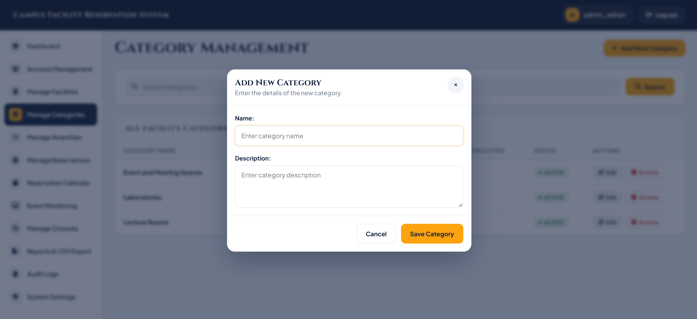

*Figure 21. Add New Category modal dialog with name and description configuration.*

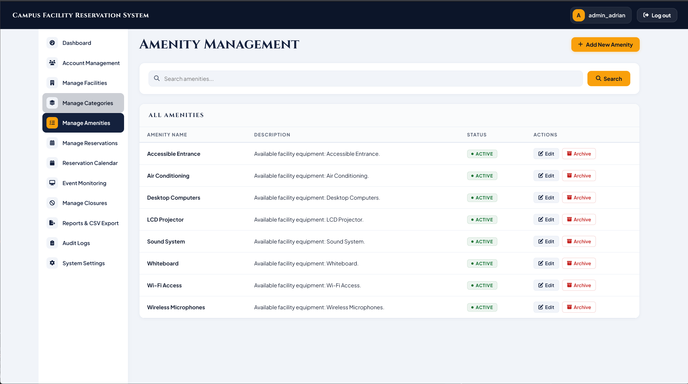

*Figure 22. Facility amenity administration table with active status badges and archive controls.*

Clicking "+ Add New Amenity" opens a modal creation dialog allowing administrators to define the amenity name and description before associating it with facilities.

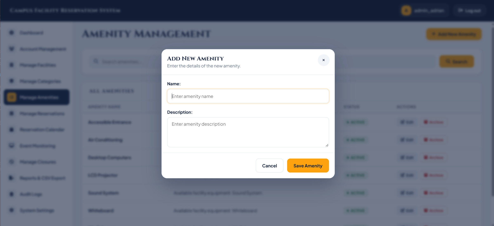

*Figure 23. Add New Amenity modal dialog with name and description configuration.*

#### Reservation Review Queue and Approval (A3)

The reservation management queue (`/manage/reservations/`) provides a centralized interface for reviewing submitted booking requests. The queue supports search by keyword, multi-status filtering (All Statuses, Pending, Approved, Rejected, Cancelled), facility filtering, date filtering, and pagination. Administrators can approve pending requests or reject them with a mandatory recorded rejection reason. Approval atomically re-validates schedule conflicts and capacity rules within a database transaction.

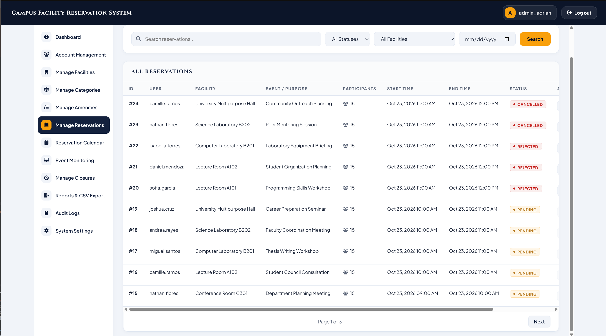

*Figure 24. Administrator reservation review queue with search, status filters, and paginated records.*

Selecting "Approve" opens an approval decision dialog prompting the administrator for an approval reason before committing the approval atomically. Supplementary captures of the status change audit timeline are cataloged in `screenshot-index.md`.

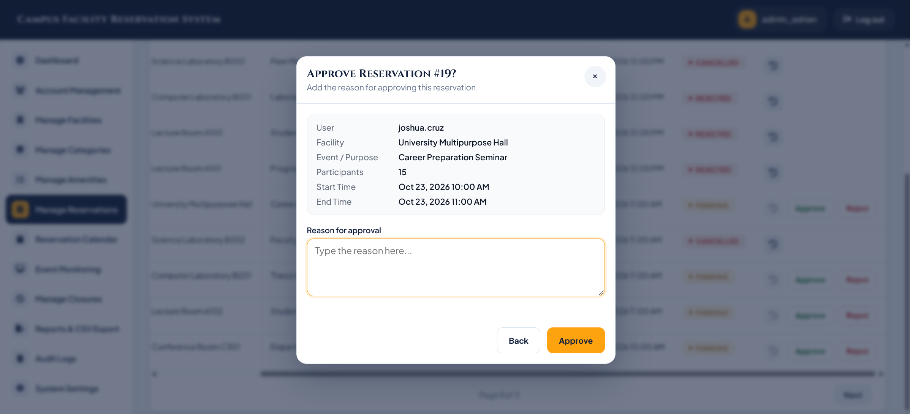

*Figure 25. Reservation approval decision modal dialog prompting for approval reason.*

Selecting "Reject" opens a rejection decision dialog requiring the administrator to record a mandatory rejection reason before confirming the terminal rejection.

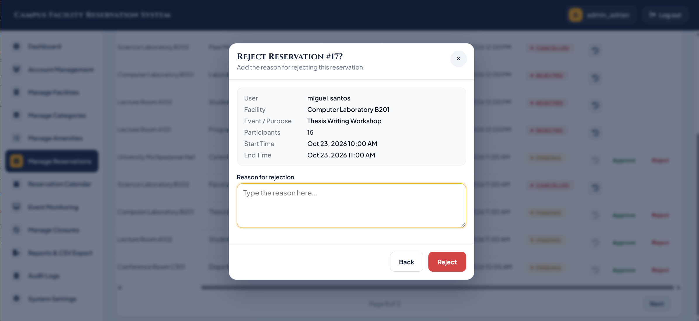

*Figure 26. Reservation rejection decision modal dialog with mandatory rejection reason textarea.*

#### Reservation Calendar and Rescheduling (A4)

The administrative calendar (`/manage/calendar/`) provides daily and weekly schedule views. The weekly interface visualizes facility availability through timeline bars indicating free vs. booked periods across operating hours. Below the timeline, scheduled reservations for the selected date are listed with facility, event title, reserving user, approved status, and action buttons for "Details" and "Reschedule". Rescheduling an approved booking requires a mandatory reason, revalidates conflicts atomically, and retains the original schedule in audit history.

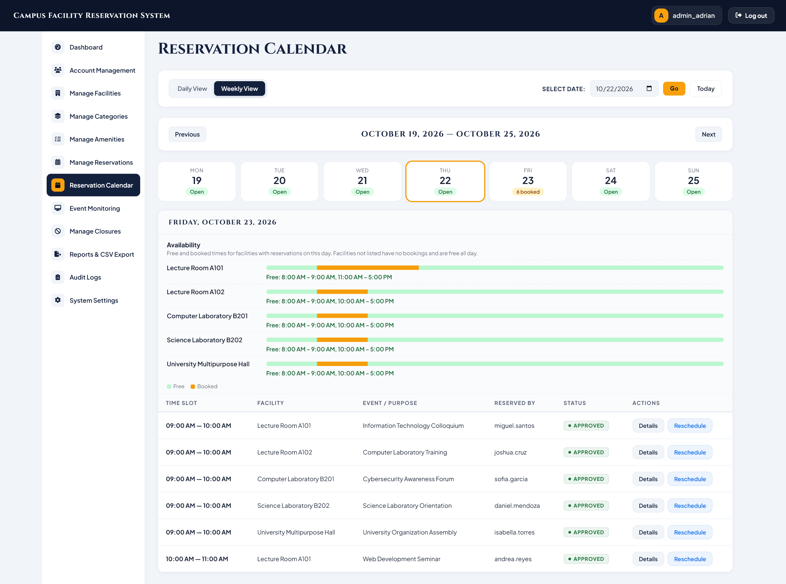

*Figure 27. Weekly reservation calendar with facility availability timeline bars, approved bookings list, and Reschedule action buttons.*

Clicking "Reschedule" for an approved reservation on the calendar opens a dedicated modal dialog allowing administrators to adjust the start and end times with a mandatory recorded reason.

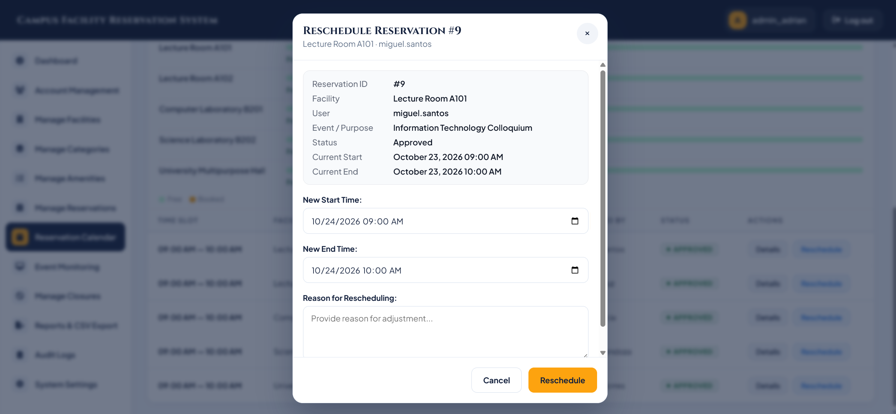

*Figure 28. Approved reservation rescheduling modal form with datetime selectors and reason input.*

#### Event Monitoring, Check-In, and Completion (A5)

The event monitoring module (`/manage/events/`) supports operational tracking for approved bookings on the day of the event. The interface displays scheduled events with facility, event purpose, reserving user, start/end times, and status. Administrators can access event operations via "View Event" to record attendee check-in during the valid scheduled window (`start_time <= now < end_time`), log event completion with actual timestamps (`actual_end >= actual_start`), record no-shows after the scheduled end time (`now >= end_time`), log event incidents, or generate a printable reservation slip via "Print Slip".

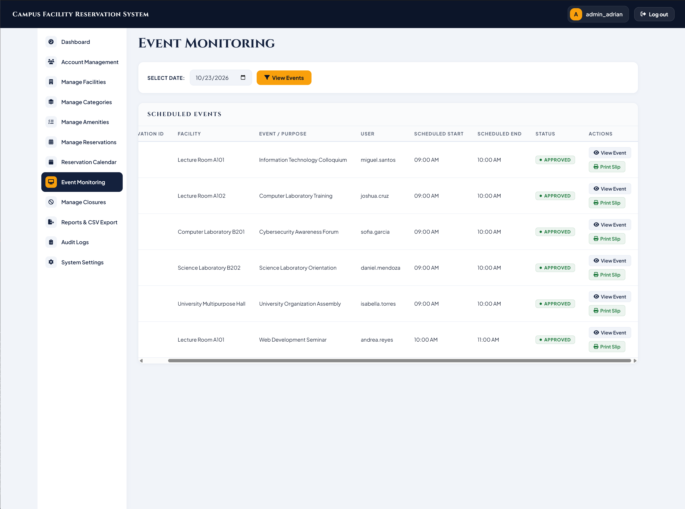

*Figure 29. Administrator daily event monitoring schedule with View Event and Print Slip action buttons.*

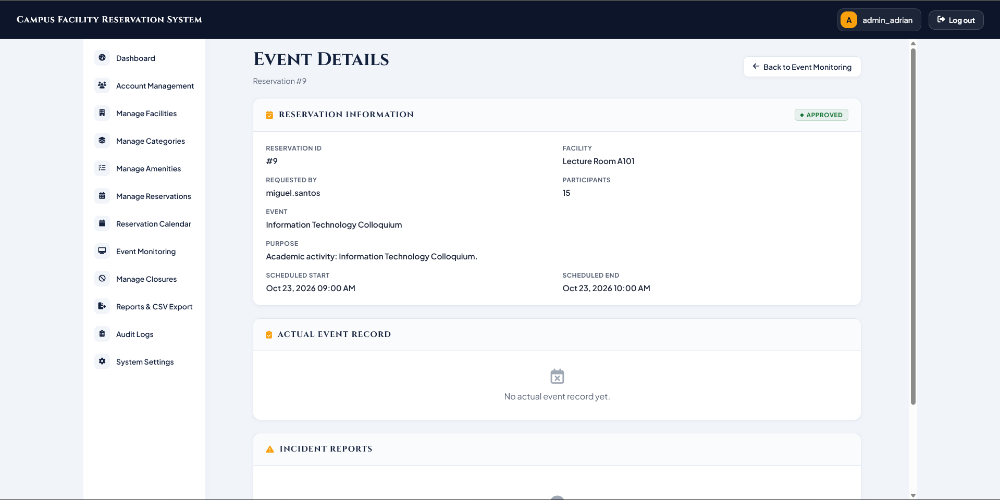

*Figure 29a. Administrator event details page (View Event) for an approved reservation.*

#### Facility Closure Management (A6)

Administrators manage maintenance shutdowns and institutional closures at `/manage/closures/`. The interface lists active closures displaying facility, start/end timestamps, maintenance reason (e.g., electrical servicing, equipment maintenance, safety inspection), creator attribution, and status. Closures cannot overlap approved or checked-in bookings. Active closures can be edited or archived via dedicated POST actions without permanently deleting historical records.

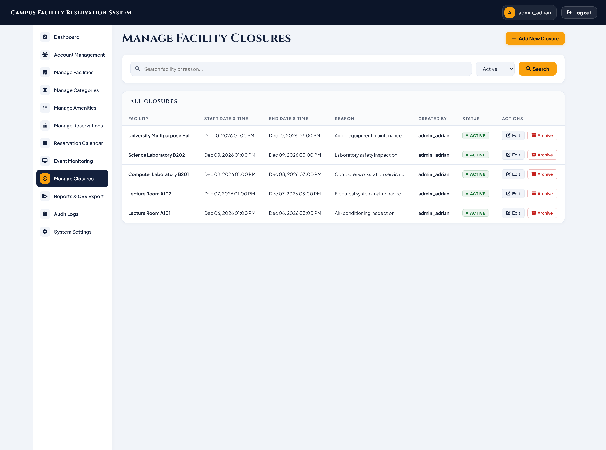

*Figure 30. Facility closure management table with scheduled closure blocks, reasons, creator attribution, and archive controls.*

Clicking "+ Add New Closure" opens a modal dialog to define the facility, start datetime, end datetime, and closure reason, with an interactive "Preview Conflicts" action to check against existing approved bookings before saving.

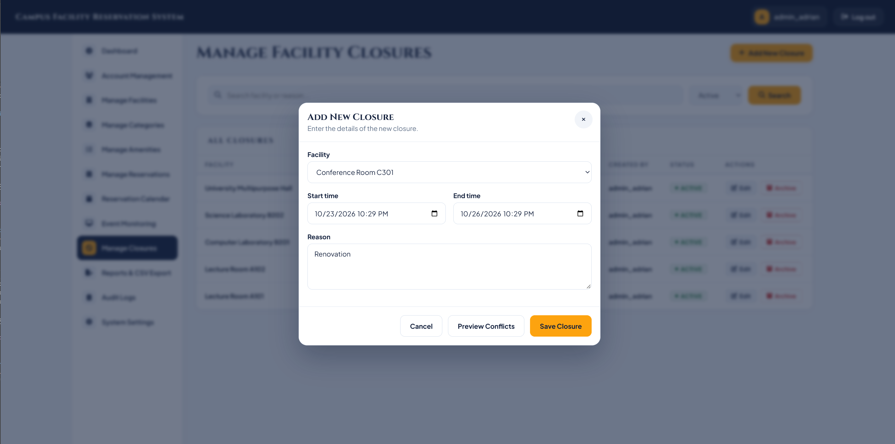

*Figure 31. Add New Closure modal dialog with datetime range, reason, and conflict preview.*

#### Reports and Utilization Analytics (A7)

The reporting interface (`/manage/reports/`) delivers operational summaries and facility utilization analytics. Administrators can filter by date range, status, and facility. The report provides summary metric cards (Total Reservations, Approved Count, Completed Count, Booked Hours), a Facility Utilization Report table with booked hours and completed event counts, and a filtered reservation records table. Administrators can export reports via "Export Reservations CSV" and "Export Utilization CSV".

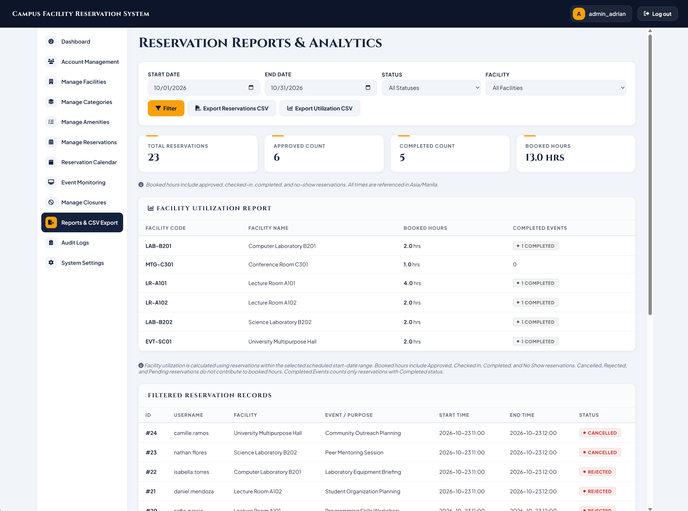

*Figure 32. Reservation reports and utilization analytics dashboard with filter controls and CSV export triggers.*

Exported CSV files provide structured operational records for reservations and facility utilization, suitable for offline reporting and spreadsheet auditing.

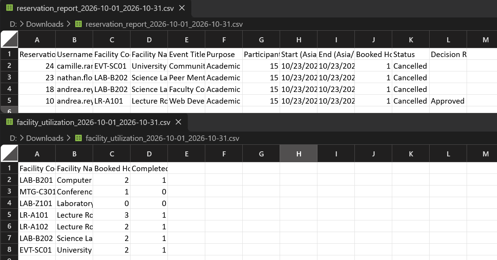

*Figure 33. Exported reservation report and facility utilization CSV spreadsheets viewed in an editor.*

#### Administrative Audit History (A8)

The audit log interface (`/manage/audit-logs/`) provides a searchable, filterable record of administrative actions and critical system state changes. Filters allow searching by keyword, action type, and date range. Recorded action types are Create, Update, Archive, Reactivate, Approve, Reject, Cancel, Check In, Complete, No Show, and Other. The table records log ID, timestamp, performing actor (`admin_user`), action verb, affected model (e.g., `FacilityClosure`, `Reservation`), object ID, and descriptive action summaries.

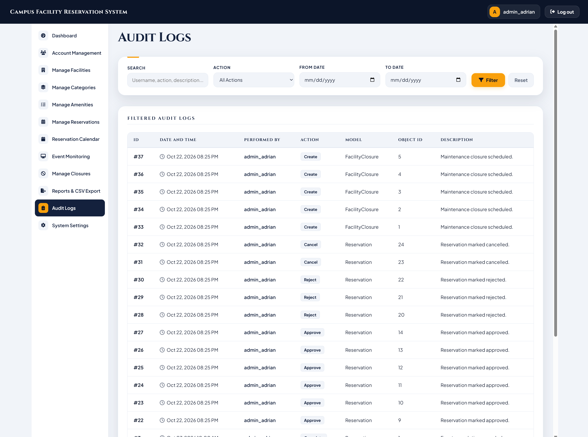

*Figure 34. Searchable and filterable administrative audit log tracking entity actions and state changes.*

#### Booking Policy Settings (A8)

Administrators configure reservation policies at `/manage/settings/`. The form allows updating the Maximum Booking Duration (in hours) and Advance Booking Window (in days). The interface displays the current active configuration, last updated timestamp, and the updating administrator attribution.

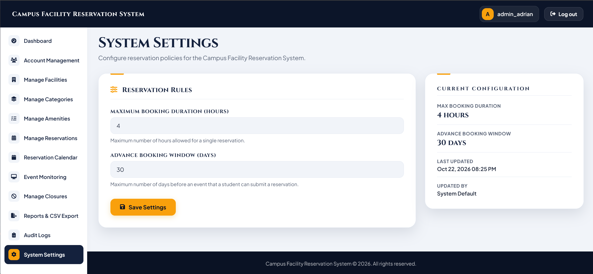

*Figure 35. System settings configuration form for maximum booking duration and advance booking window.*