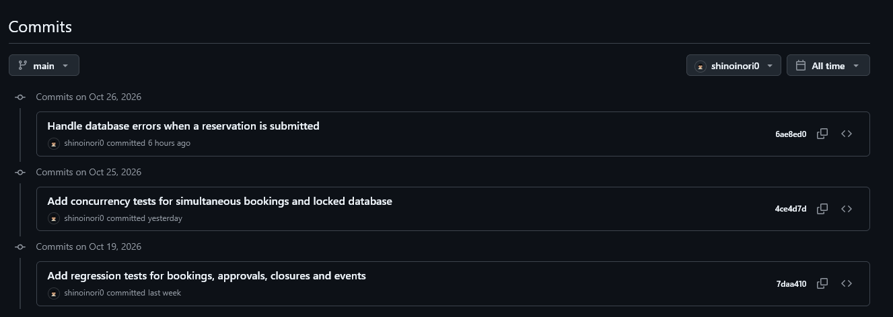
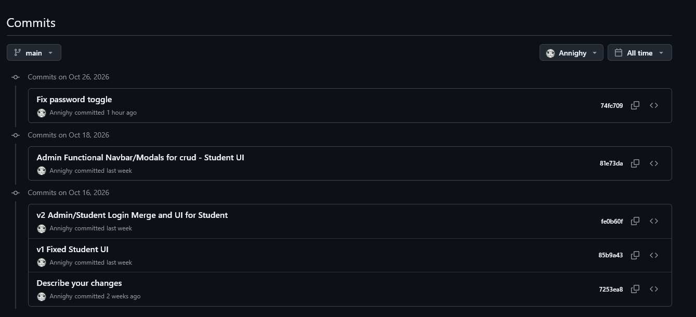
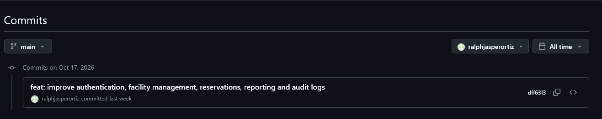
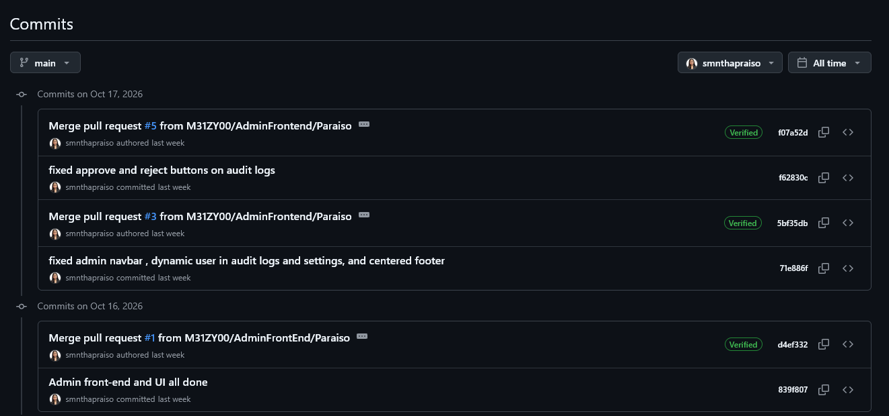
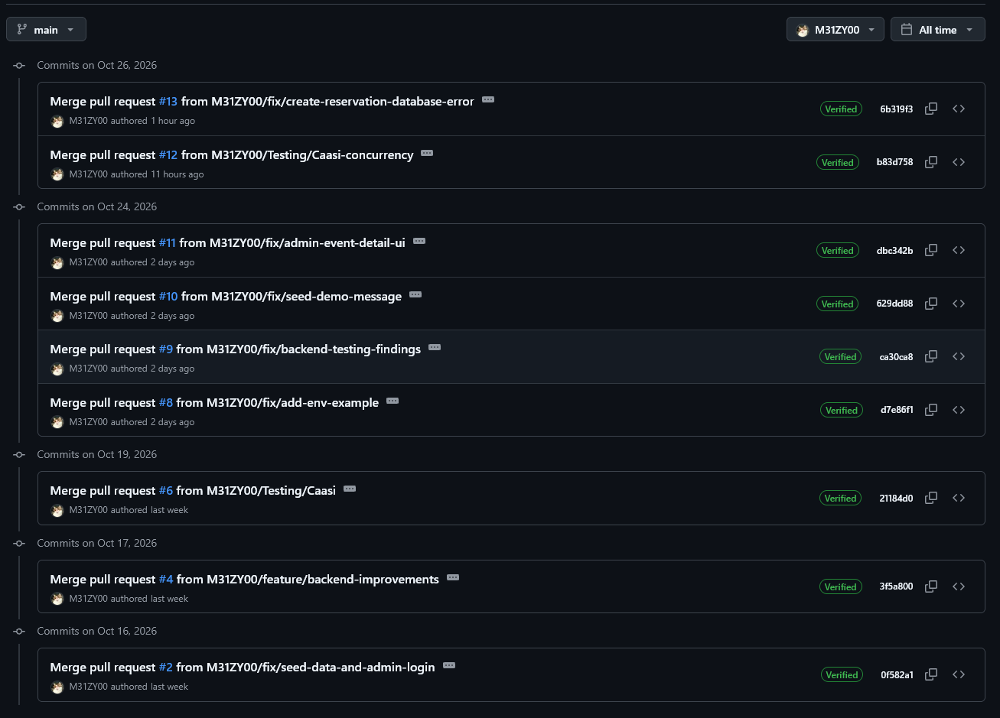

# Team Contributions and Evidence

This document summarizes the contributions of the five team members using GitHub commit history and screenshots as supporting evidence.

## Individual Contributions

### CAASI, Humphrey A.
- **Contribution:** Database & Backend Testing
- **Evidence:** 

### DE BELEN, Anne Gheela D.
- **Contribution:** Basic User Frontend + UI
- **Evidence:** 

### ORTIZ, Ralth Jasper
- **Contribution:** Backend Integration
- **Evidence:** 

### PARAISO, Samantha Nicole B.
- **Contribution:** Admin Frontend + UI
- **Evidence:** 

### SANTOS, Mischa Mae
- **Contribution:** Final Integration
- **Evidence:** 

## Documentation

**JACINTO, Joshua James E.** handled the project's documentation, including Readme.md, Install.md, and organizing contents of documentation folder.

## Evidence Notes

Screenshots show recorded GitHub commits and change notes. Contributions are described based on available evidence; commit history may not capture all work completed by each member.